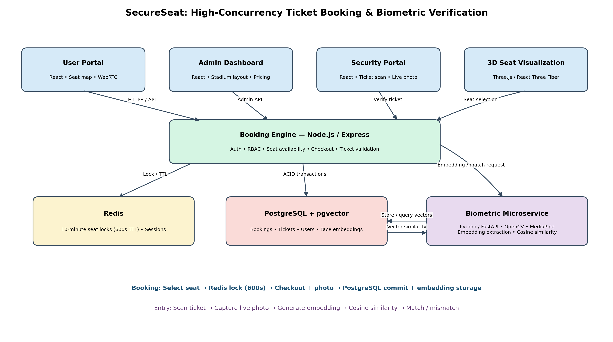

# SecureSeat: High-Concurrency Ticket Booking & Biometric Verification System

**A full-stack ticket booking platform designed for concurrent reservations, secure seat allocation, and biometric ticket-holder verification.**

SecureSeat combines a React-based booking experience, a Node.js booking engine, Redis-backed temporary seat locks, PostgreSQL transactional storage, and a Python-based facial recognition microservice.

The system aims to reduce double-booking and ticket scalping by temporarily reserving seats during checkout and associating purchased tickets with biometric identity embeddings for verification at venue entry.

---

## Table of Contents

- [Overview](#overview)
- [Key Features](#key-features)
- [System Architecture](#system-architecture)
- [Technology Stack](#technology-stack)
- [Core Workflows](#core-workflows)
- [Database and Storage Design](#database-and-storage-design)
- [Security and Reliability](#security-and-reliability)
- [Getting Started](#getting-started)
- [Configuration](#configuration)
- [Testing](#testing)
- [Limitations and Future Improvements](#limitations-and-future-improvements)

---

## Overview

Traditional ticket booking systems can experience race conditions when multiple users attempt to reserve the same seat simultaneously. Ticket resale and unauthorized transfers can also make it difficult to ensure that the person presenting a ticket is its legitimate holder.

SecureSeat addresses these challenges through two primary mechanisms:

1. **Temporary seat locking:** Redis maintains short-lived seat reservations during checkout, reducing the risk of concurrent users claiming the same seat.
2. **Biometric ticket verification:** Facial embeddings associate a ticket with its purchaser and allow security personnel to compare a live attendee photo against the enrolled reference.

The platform provides separate interfaces for customers, administrators, and venue security personnel, with a centralized booking backend coordinating reservation and verification operations.

## Key Features

### High-Concurrency Seat Locking
- Uses Redis to manage temporary seat reservations.
- Holds a selected seat for 10 minutes (600 seconds) during checkout.
- Helps prevent multiple users from reserving the same seat simultaneously.
- Releases temporary reservations when their configured time-to-live expires.

### Biometric Anti-Scalping
- Captures a customer photo during checkout.
- Uses a Python microservice to process facial images and generate vector embeddings.
- Associates the biometric reference with the corresponding ticket.
- Verifies attendees at venue entry using cosine similarity.

### Role-Based Portals
The platform provides three distinct interfaces:

| Portal | Capabilities |
|---|---|
| User Portal | Browse upcoming matches, explore stadium seating maps, select seats, and book tickets |
| Admin Dashboard | Create matches, configure stadium layouts, and manage seating-tier prices |
| Security Portal | Scan or enter ticket IDs, capture attendee photos, and verify ticket-holder identity |

### Interactive Stadium Seating
- Provides interactive seating maps.
- Supports 2D and 3D stadium visualization.
- Uses Three.js and React Three Fiber for 3D seat mapping.

---

## System Architecture



### Architecture Components

| Component | Technology | Responsibility |
|---|---|---|
| User Portal | React | Event browsing, seat selection, and booking |
| Admin Dashboard | React | Match creation, stadium configuration, and pricing |
| Security Portal | React, WebRTC APIs | Ticket lookup and live photo capture |
| Booking Engine | Node.js, Express.js | Booking coordination, seat locking, and ticket operations |
| Temporary Lock Store | Redis | Seat locks with a 600-second TTL and session management |
| Primary Database | PostgreSQL | Persistent booking data and transactional operations |
| Biometric Microservice | Python, FastAPI | Facial image processing and biometric verification |
| Face Processing | OpenCV, MediaPipe | Face detection and feature extraction |
| Vector Storage | PostgreSQL, pgvector | Storage and similarity querying of facial embeddings |

### Architectural Responsibilities

**Frontend layer**

The React portals provide user-facing functionality and communicate with the booking backend. Browser-based camera capture is used to collect images for biometric enrollment and verification.

**Booking backend**

The Node.js and Express.js backend coordinates booking operations. It interacts with Redis for temporary seat locks and PostgreSQL for durable transactional records. It also communicates with the biometric microservice when facial processing is required.

**Data layer**

Redis handles temporary reservation state, while PostgreSQL stores persistent application data. The pgvector extension supports storage and similarity-based querying of biometric embeddings.

**Biometric layer**

The FastAPI microservice separates image processing and facial verification from the main booking engine. OpenCV and MediaPipe support face detection and feature extraction, while embeddings are stored and compared using vector operations.

---

## Technology Stack

### Frontend
- React.js
- Three.js
- React Three Fiber
- HTML5 WebRTC APIs

### Main Backend
- Node.js
- Express.js
- PostgreSQL
- Redis

### Biometric Microservice
- Python
- FastAPI
- OpenCV
- MediaPipe
- PostgreSQL pgvector extension

---

## Core Workflows

### 1. Booking and Checkout

The booking process combines temporary seat reservation with durable booking storage.

1. The user browses upcoming matches and selects a seat.
2. The booking backend checks the seat's reservation status in Redis.
3. If the seat is available, Redis creates a temporary lock with a 600-second TTL.
4. The user proceeds through checkout and captures a photo.
5. The booking backend finalizes the booking in PostgreSQL.
6. The backend calls the biometric microservice to process the captured photo.
7. The generated facial embedding is stored for subsequent ticket-holder verification.

**Booking flow:**

`Select Seat → Check Redis → Acquire 600s Lock → Checkout → PostgreSQL Booking → Biometric Enrollment`

The Redis lock is temporary, while the PostgreSQL booking record is persistent.

### 2. Venue Entry and Biometric Verification

At the venue, security personnel use the Security Portal to verify ticket holders.

1. Security scans or enters the ticket ID.
2. The portal captures a live photo of the attendee.
3. The booking backend forwards the verification request to the biometric microservice.
4. The microservice detects the face and generates a facial embedding.
5. The generated embedding is compared with the stored reference embedding using cosine similarity.
6. The service returns a match or mismatch result.
7. The verification result is displayed to security personnel.

**Verification flow:**

`Scan Ticket → Capture Photo → Generate Embedding → Compare Vectors → Match / Mismatch`

Biometric similarity is a verification signal, not an infallible guarantee of identity.

### 3. Administrative Workflow

Administrators use the Admin Dashboard to manage event and seating information.

- Create matches or events.
- Configure stadium layouts.
- Manage 2D and 3D seating arrangements.
- Configure pricing for different seating tiers.

---

## Database and Storage Design

SecureSeat uses PostgreSQL and Redis for different storage responsibilities.

### PostgreSQL

PostgreSQL serves as the primary relational database and supports transactional booking operations.

It is responsible for persistent application records, including booking and ticket information.

### Redis

Redis maintains temporary seat locks and session-related state.

A seat lock uses a 600-second TTL, allowing the reservation to expire if checkout is not completed within the configured period.

### pgvector

The pgvector extension supports storing and querying facial embeddings in PostgreSQL.

Embeddings provide a numerical representation of facial features that can be compared using cosine similarity during verification.

---

## Security and Reliability

SecureSeat incorporates several security-oriented design principles:

- **Role separation:** Customer, administrator, and security workflows are separated into distinct portals.
- **Temporary reservations:** Redis locks reduce the risk of concurrent seat allocation conflicts.
- **Transactional persistence:** PostgreSQL supports reliable storage of booking operations.
- **Service isolation:** Biometric processing runs in a separate FastAPI microservice.
- **Ticket-linked verification:** Biometric comparisons use the reference embedding associated with the ticket being checked.

### Production Considerations

A production deployment would require additional validation and safeguards, including:

- Atomic lock acquisition and robust handling of lock expiry.
- Payment processing and reconciliation, if payments are introduced.
- Encryption and access controls for biometric data.
- Clear consent, retention, and deletion policies for facial data.
- Liveness detection and anti-spoofing protections.
- Configurable biometric thresholds and false-match evaluation.
- Monitoring, logging, and recovery procedures for service failures.

---

## Getting Started

### Prerequisites

Install the following software:

- Node.js v18 or later
- Python 3.10 or later
- PostgreSQL with the pgvector extension
- Redis Server, running locally or through Docker
- Git

### Installation

#### 1. Clone the repository

```bash
git clone https://github.com/yourusername/SecureSeat.git
cd SecureSeat
```

Replace `yourusername` with the actual GitHub username or repository owner.

#### 2. Set up PostgreSQL

- Install and start PostgreSQL.
- Create a database for SecureSeat.
- Install or enable the pgvector extension.
- Configure the database connection for the relevant services.

#### 3. Set up Redis

Start a Redis server locally or through Docker and ensure the booking backend can connect to it.

#### 4. Install project dependencies

Install the frontend, booking backend, and biometric service dependencies according to their respective project directories and package files.

#### 5. Configure environment variables

Create the required local environment files using the project's configuration templates.

#### 6. Start the services

Start the following components according to the scripts provided in the repository:

- Booking backend
- Frontend portals
- Biometric microservice
- PostgreSQL
- Redis

> **Note:** Add the exact installation, migration, and startup commands after confirming the repository's directory structure and scripts.

---

## Configuration

Keep secrets and credentials out of source control.

The following are examples of configuration values that may be needed, depending on the implementation:

| Variable | Purpose |
|---|---|
| `DATABASE_URL` | PostgreSQL connection string |
| `REDIS_URL` | Redis connection string |
| `PORT` | Backend service port |
| `BIOMETRIC_SERVICE_URL` | Address of the FastAPI service |
| `...` | Add the actual variables used by the application |

Provide a `.env.example` file with placeholder values for the variables the project actually uses.

---

## Testing

Validate the main workflows before deploying or presenting the project.

### Booking Tests
- Verify that concurrent users cannot successfully reserve the same seat.
- Verify that temporary locks expire after 600 seconds.
- Verify that successful checkout creates the expected persistent booking records.
- Verify that failed checkout does not leave a seat permanently locked.

### Biometric Tests
- Verify that a valid face image can be processed.
- Verify that an enrolled attendee produces the expected verification result.
- Verify that a different attendee produces a mismatch under the configured threshold.
- Verify that invalid or unreadable images are handled safely.

### Access Control Tests
- Verify that users cannot access restricted administrative operations.
- Verify that security operations require the appropriate role.
- Verify that invalid ticket IDs are rejected.

Add the actual test commands and results once they are available in the repository.

---

## Limitations and Future Improvements

Potential improvements include:

- Payment gateway integration.
- More robust distributed locking and booking recovery.
- Biometric liveness detection.
- Improved evaluation of false acceptance and false rejection rates.
- Biometric consent, retention, and deletion workflows.
- Automated integration and load testing.
- Monitoring, metrics, and structured logging.
- Containerized deployment and CI/CD automation.

---

## Project Status

SecureSeat is a project for exploring high-concurrency ticket booking and biometric verification.

Update this section with the current implementation status, known limitations, screenshots, and a demo link as the project evolves.
